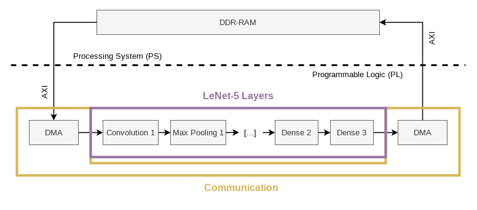
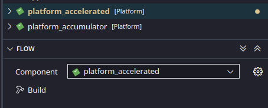
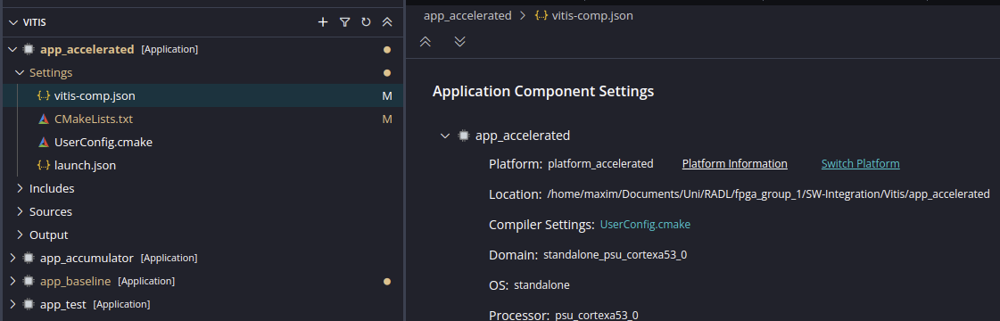

# LeNet-5 Hardware Accelerator

This repository contains all code and evaluation results for a hardware accelerated LeNet-5 architecture that was developed over the course of the project *RADL* (aka. computer architectures for deep-learning applications) at FAU (Friedrich-Alexander University Erlangen-Nuremberg).

The LeNet-5 hardware accelerator is integrated in such a way that it can be controlled via the processing system (CPU) of the target FPGA.
For high performance this uses DMA to transfer data and interrupts to notify the processing system once inference is complete.
The overall design of the integrated accelerator looks like the following:



This repository is structured as follows:

```bash
├── data                            # Contains data for test benches (e.g. intermediate results of LeNet-5)
├── LeNet-Accelerator               # The main Vivado Project used to test and integrate the hardware accelerator (includes the files from sim_1 and sources_1)
├── measurements                    # Evaluation data and helper scripts
├── reference
│   ├── simulation                  # The reference implementation of the LeNet-5 architecture
│   └── training                    # Scripts and data used to train the quantized LeNet-5 model
├── sim_1                           # VHDL test benches
├── sources_1                       # VHDL main sources for the hardware accelerator
└── SW-Integration
    ├── Vitis                       # Main Vitis project
    │   ├── app_accelerated         # Vitis project to benchmark the integrated hardware accelerator
    │   ├── app_accumulator         # Vitis project to test and run the benchmark of the integrated accumulator (unit for testing AXI-related stuff)
    │   ├── app_baseline            # Vitis project to benchmark the ported reference implementation (CPU only)
    │   ├── app_test
    │   ├── data                    # Image and layer data used in app_accelerated, app_baseline (note: this data was already pre-processed and is now stored in form of int8_t's)
    │   ├── platform_accelerated    # Platform that includes the LeNet-5 accelerator
    │   └── platform_accumulator    # Platform that includes the hardware accumulator (unit for testing AXI-related stuff)
    └── Vivado                      # Vivado project used to develop the hardware accumulator
```

## Authors

* Maxim Balajan
* Markus Gerber

## LeNet-5 Accelerator implementation

### Prerequisites

* **Vivado Version:** v2024.1
* **Vitis Version:** v2024.1
* Serial monitor such as `minicom`, `picocom` or `putty`

### Building

1. Open the Project located in [SW-Integration/Vitis](SW-Integration/Vitis/) with Vitis.
2. To run performance benchmarks for the [baseline](SW-Integration/Vitis/app_baseline/) (ported reference implementation), the [accumulator](SW-Integration/Vitis/app_accumulator/) and the [LeNet-5 hardware accelerator](SW-Integration/Vitis/app_accelerated/) open the corresponding Platform and first build it \
**Note**: The baseline platform is the same as the platform for the LeNet-5 hardware accelerator, so [*platform_accelerated*](SW-Integration/Vitis/platform_accelerated/). For the accumulator the corresponding platform is called [*platform_accumulator*](SW-Integration/Vitis/platform_accumulator/). \

3. *Optional*: If you do want to create your own platform for the Ultra96-v2 board create a corresponding Vitis platform from the generated XSA files. Then select the new platform for the app you want to run \
**Note**: Make sure that stdout is mapped to the right output interface (e.g. for Ultra96-v2 you need to select UART1 instead of UART0).
    * [XSA File for the Accumulator](SW-Integration/Vivado/main_design_wrapper.xsa)
    * [XSA File for the LeNet-5 accelerator](LeNet-Accelerator/lenet_accel_main_wrapper.xsa)
4. Power on the FPGA and connect it via UART/JTAG.
5. When selecting the specified Application, make sure that the correct Platform is used. For that edit the `app_*/Settings/vitis-comp.json` file inside Vitis and make sure the correct platform is being used. If not, change it via the `Switch Platform` button. \

6. *Optional*: If you want to capture the latencies of the benchmark, just run `cd measurements && python record_output.py`. This will connect to the serial output of `/dev/ttyUSB1` at baud rate `115200` and put all measured latency in a json file. With this script you can still see the output as if you were connected with e.g. `minicom`, `picocom`, `putty`, etc.
7. Build the application and flash the device. \
**Note**: This can take some time as the binary includes all 10,000 images and 10,000 image labels (which is pretty big). *So, have some patience and grab yourself a cup of coffee in the mean time :)* <br/><br/>
  *Example output:*

    ```
    ...
    [99%] Inference of 1 image completed in 21800ns! (current accuracy: 98%)
    [BENCH-INFO] 21800
    [99%] Inference of 1 image completed in 21800ns! (current accuracy: 98%)
    [BENCH-INFO] 21800

    Inference finished!

    --- Result ---
    Total inference duration: 0.218578s
    Avg inference duration: 21857.8ns
    Total misses: 108 of 10000 images
    Avg accuracy: 98.92%
    [BENCH-STATUS] Finished
    ```

### Architecture Overview

The LeNet-5 hardware accelerator is implemented as follows:


For more information, please have a look at the [sources_1/](sources_1/) directory.

## Reference Implementation (on Desktop)

### Requirements

* C++ 23
* CMake 3.20.0
* Protobuf (tested with version *3.21.12-9ubuntu1*, probably usable with older versions as well)

To install the required packages on Ubuntu, run: `sudo apt install cmake build-essential protobuf-compiler`

### Building

To build the project using GNU Make run:

```bash
cd reference/simulation
mkdir build
cd build
cmake ..
make -j16
```

### Targets

The executable binary targets are:

* `benchmark_datatypes`: Run the accuracy benchmark for all combinations of different datatypes
* `npy_converter`: Pre-process and convert images from numpy format into binary format. This will already pre-process the images by applying the right datatype (e.g. quantization)
* `onnx_converter`: Pre-process, convert and serialize the layer data stored inside an onnx file into the format used by the software implementation. This will automatically convert weights into the right data format (e.g. by applying quantization) and will pre-determine all layers.
* `simulation`: The software reference simulation for desktop.
* `tests`: Custom tests. Only used for... testing :)
* `test_serialize`: Test that serializing the layers works as excepted.

For running the programs you might need to input the trained model (located in `reference/training/Lenet_qonnx.onnx`) and test images and/or labels (located in `reference/training/export/mnist/`).

## License

Distributed under the GNU GPL v3 License. See LICENSE for more information.
