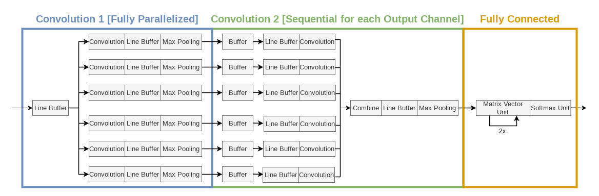

# LeNet-5 Hardware Accelerator

This repository contains all code and evaluation results for a hardware accelerated LeNet-5 architecture that was developed over the course of the project *RADL* (aka. Computer Architectures for Deep-Learning Applications) at FAU (Friedrich-Alexander University Erlangen-Nuremberg).

The LeNet-5 hardware accelerator is integrated in such a way that it can be controlled via the processing system (CPU) of the target FPGA.
For high performance this uses DMA to transfer data and interrupts to notify the processing system once inference is complete.
The overall design of the integrated accelerator looks like the following:


This repository is structured as follows:

```bash
├── _generated                      # Logging of various utilities
├── bdf                             # Bord definition files for the Ultra96-v2 board
├── doc                             
│   ├── assets                      # Images for this ReadMe
│   └── report                      # Report and Presentation Slides for the project
├── measurements                    # Evaluation data and helper scripts
├── reference
│   ├── simulation                  # The reference implementation of the AlexNet architecture
│   └── training                    # Scripts and data used to train a quantized AlexNet model
├── scripts                         # TCL scripts for creating the Vivado Projects and (Out-of-Context)-Synthesis runs
├── sources_1                       # VHDL main hardware and simulation sources for the hardware accelerator
├── SW-Integration
│   ├── app_accelerated             # Software driver for the hardware accelerated LeNet-Inference
│   └── app_baseline                # Software driver for the baseline LeNet-Inference running only on one ARM Core
└── INIT.sh                         # Init script for initializing repository with virtual environment
```

A complete report containing a detailed explanation of all things to be found in this repository can be found [here](doc/report/).

## Authors

* Maxim Balajan ([Github Profile](https://github.com/maxim-balajan))
* Markus Gerber ([Github Profile](https://github.com/markus-gerber))

## LeNet-5 Accelerator implementation

### Prerequisites

* **Vivado Version:** v2023.2
* **Vitis Version:** v2023.2
* Newest Version of [**PyEnv**](https://github.com/pyenv/pyenv) [*Tested with PyEnv 2.6.4*]
* Serial monitor such as `minicom`, `picocom` or `putty`

### 0. Initialize Repository

1. Install Python 3.10.XX using PyEnv
```bash
$ pyenv install 3.10.16
```
2. Source the INIT.sh script from project root
```bash
$ source ./INIT.sh
```
3. This creates various environmental variables needed for TCL and Python scripts and install a virtual Python environment \
**Note:** This can take some time for the first run, because it installs all packages necessary, later runs will be instant. So grab yourself a coffee in the meantime ;)

### 2. Create Vivado Project and Synthesize/Implement Design
1. Change into the Folder containing the TCL script and open Vivado:
```bash
$ cd $PRJ_ROOT_PATH/scripts/
$ vivado -nolog -nojournal -mode tcl
```
2. Source the *create_project.tcl* file. This will create the project and start the synthesis/implementation:
```bash
Vivado% source ./create_project.tcl
```
3. After implementation, this should create a *LeNet-Accelerator.xsa* file with which the design can be brought to the evaluation platform

1. Create a new Vitis platform from the generated XSA files and build it \
**Note**: Make sure that stdout is mapped to the right output interface (e.g. for Ultra96-v2 you need to select UART1 instead of UART0).
2. Create a new, empty application utilizing the previously created platform
3. Either include the sources of the [hardware accelerated application](SW-Integration/app_accelerated/) or the [baseline application](SW-Integration/app_baseline)
4. Power on the FPGA and connect it via UART/JTAG.
5. Build the application and flash the device. \
**Note**: This can take some time as the binary includes all 10,000 images and 10,000 image labels (which is pretty big). *So, have some patience and grab yourself a cup of coffee in the mean time :)* <br/><br/>
  *Example output:*

    ```
    ...
    [99%] Inference of 1 image completed in 21800ns! (current accuracy: 98%)
    [BENCH-INFO] 21800
    [99%] Inference of 1 image completed in 21800ns! (current accuracy: 98%)
    [BENCH-INFO] 21800

    Inference finished!

    --- Result ---
    Total inference duration: 0.218578s
    Avg inference duration: 21857.8ns
    Total misses: 108 of 10000 images
    Avg accuracy: 98.92%
    [BENCH-STATUS] Finished
    ```

### Architecture Overview

The LeNet-5 hardware accelerator is implemented as follows:



For more information, please have a look at the [sources_1/](sources_1/) directory.

## Reference Implementation (on Desktop)

### Requirements

* C++ 23
* CMake 3.20.0
* Protobuf (tested with version *3.21.12-9ubuntu1*, probably usable with older versions as well)

To install the required packages on Ubuntu, run: `sudo apt install cmake build-essential protobuf-compiler`

### Training

0. Source the INIT.sh script from project root
```bash
$ source ./INIT.sh
```
1. To train, run the [training script](reference/training/training.py):
```bash
$ prj_train --help
```

### Reference Inference

0. Source the INIT.sh script from project root
```bash
$ source ./INIT.sh
```

1. To build the [reference inference](reference/simulation/) using GNU Make and running it afterwards, execute:

```bash
$ prj_build_simulation
$ prj_run_simulation --help
```

## License

Distributed under the GNU GPL v3 License. See LICENSE for more information.
